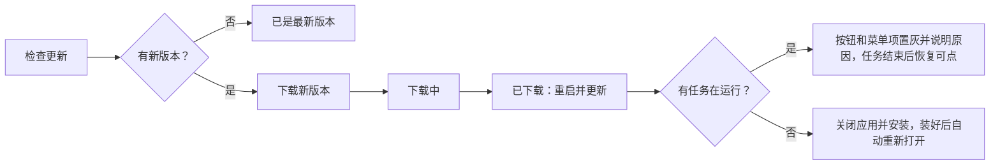

# 2026-11-14｜AnyModelBot v0.1.35 样式与体验修复（二）

**日期：** 2026-11-14（Asia/Shanghai）
**适用版本：** 基于 v0.1.35
**状态：** 讨论中

## 目录

- [一、业务背景与要解决的问题](#一业务背景与要解决的问题)
- [二、产品逻辑](#二产品逻辑)
- [三、需求详情](#三需求详情)
- [四、配套线稿](#四配套线稿)

---

## 一、业务背景与要解决的问题

本文收录 v0.1.35 走查发现的功能、样式、体验和文案问题，只修问题不加功能。已有侧栏结构（「定时」在「发现」下方、账户行右侧更新按钮、整套图标）和「设置 › 模型」顶部的余额与充值不变。

| 级 | 编号 | 问题 |
| :--- | :--- | :--- |
| P1 | 1 | 体验期内模板一律跟随全局默认，不按档位推荐也不降档 |
| P1 | 2 | 后台接着做时被权限拦下只出红色错误条，无权限卡；遗留等待状态不消失 |
| P1 | 3 | 上手清单点步骤没有反应 |
| P2 | 4 | 更新入口置灰原因只在悬停里、菜单文字不对；账户区加载是灰块、失败无重试 |
| P2 | 5 | 提示出现在窗口左下角 |
| P2 | 6 | 定时页展开的规则文字堆叠、信息重复 |
| P2 | 7 | 模板卡片无边框，看不出边界 |
| P2 | 8 | 选择机器人弹窗是纯文字竖排 |
| P2 | 9 | 新规则弹窗窄而长，类型是长条分段控件，层级不统一 |
| P3 | 10 | 英文「时区不同」说法不对 |
| P3 | 11 | 定时页中文空状态多一个空格 |
| P3 | 12 | 群聊余额不足只有通用充值按钮 |
| P3 | 13 | 「退出登录」看不出是危险操作 |
| P3 | 14 | 两处模板入口带多余箭头、看不出按钮 |
| P3 | 15 | 定时页空状态说明和按钮贴在一起 |

**通则**：本文只给中英文案，其他已有语言按确认后的中文含义在同一次开发中同步。颜色变量取值：`--well` 浅 rgba(0,0,0,.04) / 深 rgba(255,255,255,.045)；`--surface` 浅 #fff / 深 #191919；`--line` 浅 rgba(0,0,0,.1) / 深 rgba(255,255,255,.1)；`--line-2` 浅 rgba(0,0,0,.06)；`--sel` 浅 rgba(0,0,0,.055)；`--side-press` 浅 rgba(0,0,0,.07)。「统一焦点描边」指应用现有的 2px `--accent` 描边、外移 2px；「内收焦点描边」指同样描边内收 2px。

---

## 二、产品逻辑

### 模板的推荐档位

| 情况 | 预选模型 | 推荐理由 |
| :--- | :--- | :--- |
| 不在体验额度期内；或体验期内模板档位不高于全局默认所在档位 | 模板声明档位里满足能力要求的模型 | 推荐：模型智能「{档位}」 |
| 体验期内，模板档位高于全局默认所在档位 | 降到全局默认所在档位，在这一档里选满足能力要求的模型 | 当前体验额度下先用「{实际档位}」，这个模板通常更适合「{原推荐档位}」。 |
| 降档后这一档没有满足能力要求的模型 | 跟随全局默认 | 推荐档位没有满足能力要求的模型，先跟随全局默认。（只有这一种情况下方显示「通常更适合」） |

体验额度期指新账号仍在用初始体验额度的阶段；档位名只用 低 / 中 / 高。用户在预览页手动选过模型后不再自动改回，推荐理由保持打开时那一句。

### 应用内更新

两个入口（有新版本才出现的账户行更新按钮、账户菜单更新项）状态和文字一致。只在用户点「重启并更新」后安装，下载完不自动重启，普通退出不安装。有任务在运行时两处置灰并直接说明原因，任务结束后恢复可点，不排队自动重启。

### 左下角账户区

| 状态 | 条件 | 头像 / 昵称 | 重试入口 |
| :--- | :--- | :--- | :--- |
| 有缓存，读取中 | 本机存有这个账号上次成功读到的头像和昵称 | 上次的头像和昵称 | 无 |
| 无缓存，读取中 | 无缓存，从开始读取起不超过 15 秒 | 与最终头像同尺寸的灰色圆形占位；「正在连接…」，次要文字颜色 | 无 |
| 读取失败 | 超过 15 秒没有结果，或请求失败 | 有缓存用上次的；无缓存用 Modelflare 标志和「Modelflare 账号」 | 下拉箭头左边的「重试」图标；账户菜单顶部「重新读取账号信息」 |
| 正常 | 读取成功 | 账号头像（没有时用昵称首字）和昵称 | 无 |

- 任何状态下点头像和昵称都能打开账户菜单，菜单里设置、连接应用、意见和反馈、检查更新照常可用。
- 读取成功后原地替换，位置和尺寸不变，不闪动。失败后后台每 60 秒自动重试一次，切回窗口时立即一次。
- 更新按钮排在账户行最右侧，「重试」图标在下拉箭头左边，同时出现时互不遮挡。

### 电脑操作权限卡

电脑操作缺少 macOS 权限（辅助功能、屏幕录制）被拦下时，这一轮暂停，用提醒色权限卡请用户开启，不用红色错误条。

| 被拦下时在做什么 | 卡片位置 | 所需权限全部开启后 |
| :--- | :--- | :--- |
| 回复用户刚发的消息 | 这一轮回复的位置 | 30 分钟内且之后没发新消息：自动接着做，标题「已开启，继续执行」；否则标题「已开启，点击「继续」接着做」带「继续」按钮 |
| 后台命令结束后自己接着做 | 原对话里，接在这一轮后面 | 同上 |
| 后台任务、定时规则 | 「桌面对话」 | 标题「已开启，下次运行时会用上。」，不自动重跑 |

- 卡片：标题（缺 1 项 / 2 项）+ 一行说明；每项权限一行：名称、用途、状态（未开启 / 检测中… / 已开启）。
- 「去开启」主按钮请求系统授权，已请求过则打开系统设置对应页；「稍后」把卡片收起成一行，行内保留「去开启」；下方可展开「打不开？手动开启」，显示设置路径和「打开系统设置」按钮。
- 卡片显示期间每 3 秒检测一次，切回窗口立即检测，状态原地更新。
- 只差屏幕录制且需重新打开应用时，标题改为「还差一步：重新打开 AnyModelBot」，主按钮「重新打开」，聊天和草稿保留。
- 同一机器人同时只有一张权限卡；不对应任何对话或卡片的授权等待状态，在权限全部开启后自动清除，重启不残留。
- 桌面对话不再出现「电脑操作需要 macOS 授权…」红条；微信、飞书等外部渠道没有卡片，文字说明不变。

### 上手清单的步骤点击

主动点步骤必须有可见结果：能显示引导就显示，被挡住时用提示说明原因。自动出现的引导仍按原条件压住。

| 点击项 | 点击后 |
| :--- | :--- |
| 「跟机器人打个招呼」「让它记住你」「请第二位机器人帮忙」「让它交一份文件给你」 | 切到当前机器人的对话页，在输入框旁显示这一步的引导 |
| 「接到常用聊天工具」 | 切到对话页，在标题栏机器人信息按钮旁显示引导 |
| 已完成的步骤 | 同样显示引导，标为已完成 |
| 「不再显示清单」 | 清单隐藏，提示「已隐藏上手清单，可以在「设置 › 常规」里重新打开。」 |

| 情况（按优先级） | 自动引导 | 用户主动点步骤 |
| :--- | :--- | :--- |
| 有权限请求在等待（某对话里确实显示着权限卡） | 不出现 | 提示「先处理完当前的权限请求，再继续上手引导」 |
| 「需要你」里有事项（批准、回答问题、重新登录等） | 不出现 | 提示「先处理完需要你处理的事项，再继续上手引导」 |
| 当前机器人正在回复 | 不出现 | 提示「等它回复完，再继续上手引导」 |
| 当前对话最后一条是错误 / 其他机器人在忙 / 输入框里正在打字 | 不出现 | 正常显示引导 |
| 点步骤时清单菜单开着 | — | 菜单随点击关闭，关闭后立即显示引导 |

多个原因只提示最前一条；原因解除后引导不自动弹出，再点一次即可。不对应任何权限卡的遗留授权等待状态不挡清单。

### 提示（toast）

提示告诉用户操作完成或失败，不打断当前操作。

| 项目 | 规则 |
| :--- | :--- |
| 位置 | 主区（侧栏与右侧面板之间）顶部居中、标题栏下方，侧栏收起、面板开关、缩放时保持居中；无侧栏页面（登录、上手引导）在窗口顶部居中 |
| 遮挡 | 不压在侧栏、账户区、右侧面板和输入框上；不随页面滚动 |
| 宽度 | 随文字变宽，最宽 480，且不超过主区宽度减两侧留白；最多折两行，不截断 |
| 时长与关闭 | 成功和普通提示 3 秒后淡出，悬停暂停、移开重新计时，不带关闭按钮；错误提示一直留着，右侧带关闭按钮 |
| 多条 | 从上往下叠放，新的在最下面，最多 3 条，第 4 条出现时最早一条提前淡出；同一条重复出现时合并并重新计时 |
| 无障碍 | 作为状态消息由读屏软件播报，不抢焦点 |

---

## 三、需求详情

### 1. 模板：体验额度期内降档（P1）

**当前表现**：体验期内一律跟随全局默认，理由为「上手期间先跟随全局默认，你也可以自己选择。」，下方另有「这个模板通常更适合模型智能「{level}」。」。

**要求表现**：按「模板的推荐档位」处理；旧句不再使用；降档时下方不显示「通常更适合」。

| 位置 | 中文 | English |
| :--- | :--- | :--- |
| 推荐理由（正常） | 推荐：模型智能「{level}」 | Recommended: {level} intelligence |
| 推荐理由（降档） | 当前体验额度下先用「{actualTier}」，这个模板通常更适合「{originalTier}」。 | On the trial quota this bot starts with {actualTier} intelligence. This template usually works better with {originalTier} intelligence. |
| 降档后无可用模型（不变） | 推荐档位没有满足能力要求的模型，先跟随全局默认。 | No model in the recommended tier meets the requirements; following the global default. |
| 档位名 | 低 / 中 / 高 | Low / Medium / High |

**验收**：体验期、全局默认「低」时，「资料研究员」（高档）预选低档并显示降档理由、下方无「通常更适合」，「写作助手」（低档）为「推荐：模型智能「低」」；非体验期「资料研究员」为「推荐：模型智能「高」」；手动换模型后改头像名称不被改回；英文一致。

### 2. 电脑操作：后台接着做时被权限拦下也出权限卡（P1）

**当前表现**：让机器人操作电脑时，若它先在后台跑命令、结束后自己接着做时被拦下，对话里只出现红色错误条「电脑操作需要 macOS 授权（辅助功能），任务因缺少权限未能继续。按界面上的说明开启后，可以重新发送。」，没有权限卡，开启后只能重发。留下的授权等待状态不对应任何对话，开启后不清除、重启后仍在，所有对话（含没有报错的新对话）里的上手清单都被挡住。只有回复刚发的消息时被拦才正常出卡。

**要求表现**：所有被拦情况按「电脑操作权限卡」处理；后台接着做时卡片在原对话，开启后自动接着做或点「继续」，不需重发；遗留等待状态按规则清除。开发时先在 macOS 复现确认：关掉辅助功能，让机器人先跑后台命令再操作电脑，看到上述红条再改。

| 位置 | 中文 | English |
| :--- | :--- | :--- |
| 标题（缺 1 项 / 缺 2 项） | 需要你开启一个权限 / 需要你开启 {count} 个权限 | One permission needed / {count} permissions needed |
| 说明 | 电脑操作要用到下面的系统权限，开启后我会接着做。 | Computer Use needs the system permissions below. I will continue once they are on. |
| 权限名 | 辅助功能 / 屏幕录制 | Accessibility / Screen Recording |
| 用途（辅助功能 / 屏幕录制） | 用于替你点击、输入和操作窗口。 / 用于查看屏幕上的内容，判断下一步怎么操作。 | Lets it click, type and work with windows for you. / Lets it see what's on screen to decide what to do next. |
| 状态 | 未开启 / 检测中… / 已开启 | Off / Checking… / On |
| 按钮 | 去开启 · 稍后 · 继续 · 重新打开 | Turn on · Later · Continue · Reopen |
| 收起后 | 电脑操作暂停，等待开启权限 | Computer Use is paused until permission is on |
| 手动开启 | 打不开？手动开启 | Can’t open it? Turn it on manually |
| 设置路径 | 打开「系统设置 → 隐私与安全性 → {item}」，打开 AnyModelBot。 | Open System Settings → Privacy & Security → {item}, then turn on AnyModelBot. |
| 开启后（自动接着做） | 已开启，继续执行 | Permission on. Continuing |
| 开启后（需点继续） | 已开启，点击「继续」接着做 | Permission on. Click Continue to resume |
| 开启后（后台任务、定时规则） | 已开启，下次运行时会用上。 | Permission on. It will be used on the next run. |
| 需重新打开应用 | 还差一步：重新打开 AnyModelBot | One more step: reopen AnyModelBot |
| 需重新打开应用（说明） | 重新打开后屏幕录制才会生效，聊天和草稿都会保留。 | Screen Recording takes effect after reopening. Your chats and drafts are kept. |

**验收**：
- 先跑后台命令再操作电脑：出「需要你开启一个权限」卡（两项都关时为「需要你开启 2 个权限」、各一行），有「去开启」「稍后」，无红条。
- 开启权限 3 秒内对应行变「已开启」，全部开启后接着做或出「继续」；「稍后」后收起成一行，行内「去开启」可用。
- 回复消息时被拦卡在这一轮位置；后台任务、定时规则被拦卡在「桌面对话」，开启后为「已开启，下次运行时会用上。」。
- 开启后重启：侧栏无权限等待，清单步骤能点出引导；英文与上表一致。

### 3. 上手清单：点步骤必须有反馈（P1）

**当前表现**：点任一步骤后菜单收起、没有任何变化；没有报错的新对话里同样如此（已在 macOS 复现）。原因是步骤引导和自动引导共用压住条件且静默，加上第 2 项的遗留等待状态对所有对话生效。

**要求表现**：按「上手清单的步骤点击」处理；只有某个对话里确实显示着权限卡才算权限请求在等待，遗留状态不挡清单并按第 2 项清除。开发时先在 macOS 复现确认：在没有报错的新对话、最后一条是错误、有权限请求在等待三种情况下点步骤，确认没反应再改。

| 位置 | 中文 | English |
| :--- | :--- | :--- |
| 被权限请求挡住 | 先处理完当前的权限请求，再继续上手引导 | Finish the pending permission request first, then continue the checklist. |
| 被「需要你」挡住 | 先处理完需要你处理的事项，再继续上手引导 | Take care of the things that need you first, then continue the checklist. |
| 当前机器人在回复 | 等它回复完，再继续上手引导 | Wait for it to finish replying, then continue the checklist. |
| 隐藏清单（不变） | 已隐藏上手清单，可以在「设置 › 常规」里重新打开。 | Checklist hidden. You can turn it back on in Settings › General. |

**验收**：
- 无阻挡时点 5 步，每次 1 秒内显示引导；在设置页点会先切到对话页。
- 新开没有报错的对话，每一步都有正确引导或提示；遗留等待状态清除后，所有对话的清单恢复正常。
- 最后一条是错误、或其他机器人在回复时，点步骤正常显示引导；有权限卡等待、「需要你」有事项时显示对应提示。
- 「不再显示清单」后出现隐藏提示；自动引导在错误、他人忙、打字时仍不出现；英文与上表一致。

### 4. 更新入口与账户区加载态（P2）

#### 4.1 更新入口

**当前表现**：按钮文字只在悬停提示里（「下载更新 · {version}」「重启并更新 · {version}」）；有任务在运行时按钮置灰、点了没反应，原因只在悬停里。菜单已下载时写状态句「{version} 已下载，重启后更新」，应用内更新也写带 ↗ 的「去下载」。

**要求表现**（按钮位置、图标和点击行为不变）：有任务在运行时按钮显示置灰但仍可悬停、点击、聚焦，点击后上方弹出原因气泡，3 秒或点别处收起、不重启，读屏同时读出原因；菜单项置灰并在下方显示原因；任务结束后恢复。菜单已下载写「重启并更新到 {version}」，点了直接重启；应用内更新写「下载新版本 {version}」不带 ↗，只有去浏览器下载才带 ↗。按钮悬停和菜单用同一句。

| 状态 | 中文 | English |
| :--- | :--- | :--- |
| 有新版本（应用内更新） | 下载新版本 {version} | Download version {version} |
| 有新版本（需去浏览器下载） | 发现新版本 {version}，去下载 ↗ | Version {version} is available — download ↗ |
| 下载中 | 正在下载 {version} · {percent}% | Downloading {version} · {percent}% |
| 已下载 | 重启并更新到 {version} | Restart to update to {version} |
| 有任务在运行（气泡、菜单项下方） | 有任务在运行，完成后可以重启更新 | Tasks are running. You can restart to update when they finish. |
| 正在重启 | 正在重启并更新… | Restarting to update… |

**验收**：下载完菜单为「重启并更新到 {version}」、按钮悬停同句，点后关闭、安装并重开；有任务时点按钮出气泡 3 秒收起不重启，菜单项置灰带同句，任务结束后恢复不自动重启；应用内更新不带 ↗。

#### 4.2 账户区加载态

**当前表现**：无缓存加载时头像是灰方块、昵称是灰长条；失败后无重试入口。

**要求表现**：按「左下角账户区」显示；失败时「重试」图标悬停提示原因，点了回到读取中、最长再等 15 秒，菜单「重新读取账号信息」作用相同。昵称过长省略、悬停显示全称；头像打不开用昵称首字。用自己的 Key、未登录 Modelflare 时保持「登录 Modelflare」入口。

| 位置 | 中文 | English |
| :--- | :--- | :--- |
| 无缓存，读取中 | 正在连接… | Connecting… |
| 失败时昵称（无缓存） | Modelflare 账号 | Modelflare account |
| 重试按钮悬停提示 | 账号信息暂时取不到，点击重试 | Couldn't load your account info. Click to retry. |
| 重试按钮无障碍标签 | 重试读取账号信息 | Retry loading account info |
| 菜单项（失败时） | 重新读取账号信息 | Reload account info |

**验收**：有缓存时重启即显示上次头像昵称、成功后不跳动；无缓存为圆形占位和「正在连接…」；断网 15 秒后出现两处重试入口，恢复网络点任一处或 60 秒内、切回窗口自动恢复；与更新按钮同时出现时都能点；任何状态都能打开账户菜单。

### 5. 提示位置：从窗口左下角移到主区顶部居中（P2）

**当前表现**：所有全局提示（成功和错误）都在窗口左下角、账户区上方，长提示越过侧栏；只有机器人设置页「已保存」在主区顶部。成功提示约 1.6 秒淡出，多条从下往上堆。

**要求表现**：全部按「提示（toast）」显示，机器人设置页「已保存」统一；侧栏左下角不再出现提示；从模板添加后切到新机器人对话页，提示显示到时长结束。文案不变：

| 场景 | 中文 | English |
| :--- | :--- | :--- |
| 从模板添加成功 | 「{name}」已加入「{group}」，随时可以在机器人设置里改。 | {name} is now in {group}. Change it anytime in bot settings. |
| 保存 / 复制 / 重命名 | 已保存 / 已复制 / 已重命名 | Saved / Copied / Renamed |
| 隐藏上手清单 | 已隐藏上手清单，可以在「设置 › 常规」里重新打开。 | Checklist hidden. You can turn it back on in Settings › General. |

**验收**：常规设置和机器人设置页的「已保存」位置相同；提示在主区顶部居中、不压侧栏和输入框、3 秒淡出、悬停不消失；开右侧面板或收侧栏后仍居中；错误提示点关闭才消失；4 条最多显示 3 条、新的在下，重复保存只一条；左下角不出现提示。

### 6. 「定时」页：展开的规则卡片重新分区（P2）

**当前表现**：规则直接排在白底上；展开后十余行 13px 灰字以 12px 间距堆叠，频率和下次运行重复出现。

**要求表现**：每条规则一张卡片；展开后头部下方各区间距 16，最后一区下留 16。

| 元素 | 规格 | 状态与规则 |
| :--- | :--- | :--- |
| 卡片 | 背景 `--well`，无边框，圆角 20（`--r-card-lg`），左右内边距 16（`--group-pad`）；同一机器人下卡片间距 8；机器人名称标题不变 | 关闭的规则：标题和摘要用 `--muted`，底色不变 |
| 头部 | 高 52，左右 16，垂直居中，间距 12；依次为状态点、标题块、发到哪、「立即运行」、开关、展开箭头 | 整块点击展开/收起；悬停叠 `--pill`，按下叠 `--pill-hover`，内收焦点描边；点开关和按钮不展开 |
| 状态点 | 7px，现有 `.dot` | 正常绿、需要处理琥珀、出错红、关闭灰 |
| 标题 | 15px（`--fs-lg`）/500，`--fg`，单行省略 | — |
| 摘要 | 标题下方 2px，13px `--muted`，「{频率} · 下次 {时间}」 | 只在收起时显示；需要处理时 `--amber` |
| 发到哪 | 靠右，13px `--muted`，最宽占头部 28%，超出省略 | 只在收起时显示；未选时琥珀色「还没选发到哪里」 |
| 「立即运行」 | 现有小号按钮，开关左边 | 只在需要处理时出现在头部 |
| 开关 / 箭头 | 现有开关；12px 右向箭头 `--muted` | 箭头展开时转 90°，过渡 150ms |
| 提示词区 | 小标签（现有 `.t-label`，12px/600 `--muted`）距引用块 6；引用块背景 `--surface`，圆角 16（`--r-card`），内边距 12 16，无边框；正文 14px `--fg` 行高 1.5，可选中，不加引号 | 提醒类规则标签为「提醒内容」，其他为「提示词」 |
| 属性区 | 两列网格，标签列宽按最长标签，列间距 16，行间距 8，首行基线对齐；标签 13px `--muted`，值 14px `--fg` 可折行；只显示有内容的行 | 见下方行规则 |
| 操作行 | 左为现有分段控件（观察 / 执行 / 关），右为现有小号「立即运行」，两端对齐，间距 8，放不下换行 | 提醒类规则不显示「开 / 关」分段控件（与头部开关重复） |
| 说明文字 | 操作行下方 6，13px `--muted`，行间距 4 | 内容与条件不变：检查类观察模式先显示现有观察说明；「关闭会停止尚未完成的运行；已产生的费用仍保留。」照常在最后一行；不新增模式说明 |
| 运行记录 | 上方 1px `--line-2` 分隔线（缩进到 16），线下 12 为小标签「运行记录」，再下 6 为列表；记录行样式不变 | 无记录时「还没有运行过」13px `--muted`；「更早的」放列表末尾 |
| 次要操作 | 同样分隔线，线下 12 左对齐「编辑」「导出」「删除」（现有文字按钮，删除为红色危险样式），间距 8 | — |
| ≤760px | 收起时发到哪换到第二行与标题对齐；属性区单列，标签在上值在下，间距 2，组间 10；分段控件占满一行，「立即运行」换行右对齐 | — |

属性区的行：「频率」= {频率} · {时区}，时区和电脑不同时值下方显示现有琥珀色时区提示和「改用当前时区」；「下次运行」= 时间，关闭时「已关闭」，暂停时为暂停原因；「发到」= 目标，未选时琥珀色「还没选发到哪里」；「整理哪个群」只在群聊整理类规则显示；「本月花费」=「约 {spent} / {budget}」，没有花费但有估算时显示现有估算句。展开时头部摘要和发到哪隐藏，原「下次… · 发到…」「{频率} · {时区}」两行删除。

| 位置（新增） | 中文 | English |
| :--- | :--- | :--- |
| 提示词 / 提醒内容标签 | 提示词 / 提醒内容 | Prompt / Reminder |
| 属性标签 | 频率 / 下次运行 / 发到 / 本月花费 | Schedule / Next run / Sends to / This month |
| 本月花费的值 | 约 {spent} / {budget} | About {spent} of {budget} |

其余文字（整理哪个群、运行记录、还没有运行过、立即运行、观察说明、关闭说明等）不变。

**验收**：
- 浅灰圆角卡片间距 8、收起高 52；展开顺序为头部、白底提示词、标签 + 值、分段控件和「立即运行」、关闭说明（观察模式上方有观察说明）、运行记录、「编辑 导出 删除」，频率、下次运行、发到哪各只出现一次。
- 提醒类为「提醒内容」且无「开 / 关」分段控件；时区不同时「频率」下有提示和「改用当前时区」。
- 点开关不展开，Tab 聚焦头部有内收描边；≤760px 属性区单列且文字不重叠不截断；深色模式各层可辨。

### 7. 模板页：模板改为带边框的卡片（P2）

**当前表现**：卡片与页面同为白底、无边框，网格间距 12，文字连成一片；「＋ 添加」已在头部右侧，与头像、名称同一行。

**要求表现**：

| 元素 | 规格 | 状态与规则 |
| :--- | :--- | :--- |
| 网格 | 列数和断点不变（3 / ≤900px 2 / ≤560px 1）；横纵间距 16（`--space-4`）；同一行卡片等高 | 单列时布局不变 |
| 卡片 | 背景 `--surface`，边框 1px 实线 `--line`，圆角 20（`--r-card-lg`），内边距 20（`--card-pad`），竖向排列，块间距 12（`--stack-gap`） | 悬停背景 `--well`、边框不变；按下 `--side-press`；过渡 150ms；统一焦点描边沿卡片圆角 |
| 头部 | 一行垂直居中，间距 12：48px 圆形头像（现有组件）、名称和分类、「＋ 添加」 | 名称过长时折行 |
| 名称 / 分类 | 名称 15px（`--fs-lg`）/500 `--fg` 可折行；分类在下方 4，12px `--muted`，添加过时接「 · 已添加过」 | — |
| 「＋ 添加」 | 现有小号次要按钮，高 28，胶囊形，保持在头部右侧，顶端对齐头像 | 可单独聚焦；点击同样打开预览 |
| 描述 | 13px `--fg-2`，行高 1.5，最多 2 行省略 | — |
| 试着说 | 浅灰块：背景 `--well`，圆角 12，内边距 8 12；13px `--muted` 行高 1.5，最多 2 行省略 | — |
| 底部元信息 | 贴底（margin-top: auto）；上方 1px `--line-2` 分隔线，线下 12；「适合搭配 …」「含定时规则（默认关闭）」各一行，12px `--muted`，单行省略、悬停看全称，行距 4 | 两项都没有时整块和分隔线不显示 |

点卡片任意位置打开模板预览，和现在一致。文案不变（名称、分类、「添加」、「试着说：「{prompt}」」、「适合搭配 {apps}」、「含定时规则（默认关闭）」）。

**验收**：深浅色下卡片都有 1px 边框、20 圆角，间距 16；「添加」仍在右上角；「试着说」为浅灰块，元信息有细线并贴底、同行底部对齐；悬停变浅灰、按下更深；点卡片或「添加」打开预览；按断点变 2 列、1 列不乱。

### 8. 新规则：选择机器人弹窗改为可选列表（P2）

**当前表现**：「定时」页点「新规则」且有多个机器人时，弹窗（宽 460、内边距 24）里机器人名称是一列纯文字按钮，没有头像和说明，只有悬停才有底色；列表最高为窗口高度的 55%，右下角只有「取消」。

**要求表现**：

| 元素 | 规格 | 状态与规则 |
| :--- | :--- | :--- |
| 弹窗 | 宽 420，内边距 24，圆角 24（`--r-pane`）；标题「给哪个机器人建？」不变（20px/600）；标题到列表、列表到「取消」各 16 | — |
| 列表 | 按侧栏顺序；左右外伸 10（`--item-px`）使行内文字与标题对齐；行间距 2；最高 360（约 6–7 行） | 超出只在列表区滚动 |
| 行 | 高 52，内边距 8 10，圆角 14（`--r-item`），整行是按钮；32px 圆形头像（复用侧栏头像），头像到文字 12 | 悬停背景 `--sel`，按下 `--pill-hover`，内收焦点描边；上下方向键移动，回车选中；点一下或回车直接进入新规则表单 |
| 名称 | 14px/500 `--fg`，单行省略 | — |
| 简介 | 名称下方 2，12px `--muted`，单行省略，取人设第一行 | 人设为空时不显示这一行，名称垂直居中 |
| 搜索框 | 标题下 12，现有输入框，高 36，左侧放大镜 | 超过 8 个机器人才显示，打开即聚焦，按名称过滤；无结果时列表区一行灰字 |

只有一个机器人时不弹此窗，直接进入表单（现状不变）。

| 位置（新增） | 中文 | English |
| :--- | :--- | :--- |
| 搜索框占位 | 搜索机器人 | Search bots |
| 无搜索结果 | 没有找到「{query}」 | No bots match "{query}" |

**验收**：弹窗宽 420，每行有头像、名称和灰色简介，行高 52；悬停有浅灰圆角底，方向键可逐行移动、回车进入表单；10 个机器人时出现搜索框并能过滤，列表超过 360 时只在列表内滚动。

### 9. 「新规则」弹窗：比例、分组和类型卡片（P2）

**当前表现**：宽 460，整窗滚动，标题和按钮会滚出视野；顶部是通栏分段控件「发一句提醒 / 让它做件事」；「更多」单独占一行；各块间距都是 12，组标题是 12px 灰字，和字段标签差不多。

**要求表现**：

| 元素 | 规格 | 状态与规则 |
| :--- | :--- | :--- |
| 弹窗 | 现有宽对话框 640（`.sheet.wide`），窗口窄时为窗口宽减两侧各 16；最大高度为窗口高减上下各 16 且不超过 720；圆角 24 | — |
| 头部 | 固定；内边距 24 24 16；左标题「新规则」20px/600，右关闭按钮 | 内容区滚动后才显示下沿 1px `--line-2` |
| 内容区 | 左右 24，上下 20，唯一滚动区 | 分组顺序：类型（仅新建）→ 内容（名称、提醒的话 / 要做什么）→ 什么时候 → 结果发到（编辑群聊整理类规则时含「整理哪个群」）→ 建好后（仅新建）→ 高级（默认折叠） |
| 底部 | 固定；内边距 16 24 24；上沿 1px `--line-2`；「取消」「建好」（主）右对齐，间距 8 | — |
| 间距与层级 | 组间 24；组标题到控件 8；组内控件间 12；字段标签到输入框 6；组标题 14px/600 `--fg`；字段标签 13px/500 `--fg-2`；说明 13px `--muted` 行高 1.5 | 输入框为现有组件，占满宽，高 36；「要做什么」多行，至少 3 行 |
| 类型卡片 | 「名称」之前，两张并排各占一半，间距 12；最小高 76，内边距 14 16，圆角 16（`--r-card`）；左为 36px 方块（圆角 12）内含 20px 图标（提醒用现有对话气泡、做事用现有星芒），到文字 12；标题 14px/600 `--fg`，说明下方 2，13px `--muted` 最多 2 行 | 未选中：`--surface`、1px `--line`，方块 `--well`、图标 `--fg-2`；悬停 `--well`；按下 `--pill-hover`；选中：2px `--accent` 描边（1px 边框加 1px 内描边，不跳动）、背景 `--sel`、方块 `--surface`、图标 `--fg`；统一焦点描边；左右键切换，空格/回车选中；单选组，读屏名称「到点要它做什么」（不显示）；<520px 上下排列；编辑已有规则时不显示 |
| 什么时候 | 频率分段控件（每天 / 工作日 / 每周 / 每月 / 一次）后同行接带向下箭头的文字按钮「更多」，间距 8；时间、日期输入框在下方 8，宽按内容，高 32；星期选择用现有小胶囊 | 展开「更多」箭头朝上，下一行出现「每隔 / cron」分段控件，选中其一时第一排无选中态 |
| 时间说明块 | 时区、接下来两次、每月次数合成一块：背景 `--well`，圆角 12，内边距 10 12，13px `--muted`，行间距 2 | 次数过多的琥珀色提醒和错误文字在块下方 6 |
| 结果发到 | 单选列表在 `--well` 块里，圆角 16，内边距 6，最高 240 块内滚动；分区小标签（桌面对话 / 群聊 / 渠道）12px/600 `--muted`，内边距 8 10 4；选项行最小高 40，左右 10，圆角 10，圆点到文字 10，名称 14px `--fg`，「默认」在右侧 12px `--muted` | 悬停 `--sel`；选中行 `--sel`、名称 500、圆点 `--accent`；块下 6 为现有说明「也可以发到…」 |
| 建好后 | 保留现有分段控件「马上打开 / 先关着」 | 选「先关着」时下方 6 显示现有说明 |
| 高级 | 文字按钮「高级」，左侧右向箭头；展开内容放在 `--well` 块（圆角 16，内边距 16），控件间距 12，内容不变 | 展开时箭头转 90° |

| 位置（新增） | 中文 | English |
| :--- | :--- | :--- |
| 「发一句提醒」卡片说明 | 到点我提醒你一句，不做别的事。 | When it's time, I'll just remind you—nothing else. |
| 「让它做件事」卡片说明 | 到点我自己动手做完，把结果发给你。 | When it's time, I'll do the task myself and send you the result. |

卡片标题「发一句提醒」「让它做件事」、读屏名称「到点要它做什么」及其余文字不变。

**验收**：宽 640，只有内容区滚动，标题和按钮始终可见；名称上方两张类型卡片，默认选中「让它做件事」（深色描边加浅底，另一张细边框白底），悬停未选中变浅灰、方向键可切换；组间距 24、组标题醒目；「更多」与频率同行；时间说明和结果发到都在浅灰块里，选中行有浅底，目标多时块内滚动；<520px 时卡片上下排列不溢出。

### 10. 英文「时区不同」提示（P3）

**当前表现**：英文写「Runs in {zone}, which differs from this computer’s time zone」，和中文说法不一致。

**要求表现**：英文改为下表；中文和「改用当前时区」按钮不变。

| 位置 | 中文 | English |
| :--- | :--- | :--- |
| 时区不同 | 按{zone}运行，和这台电脑现在的时区不同 · 改用当前时区 | Runs in {zone}, not this computer's current time zone · Use current time zone |

**验收**：英文界面时区不同时显示上表英文；中文不变。

### 11. 「定时」页中文空状态多余空格（P3）

**当前表现**：空状态两句之间固定加半角空格，中文显示为「还没有规则。 可以直接对机器人说：…」。

**要求表现**：两句按界面语言拼接：中文、日文不加空格，英文等用空格分词的语言保留一个空格；文字不变。第 15 项把两句拆成标题和说明后此处不再拼接，在那之前按本项处理。

| 位置 | 中文 | English |
| :--- | :--- | :--- |
| 空状态 | 还没有规则。可以直接对机器人说：「每个工作日 8:30 提醒我看今天的安排」。 | No rules yet. You can just tell a bot: "Every weekday at 8:30, remind me to check today's plan." |

**验收**：中文句号后无空格；英文两句之间有一个空格。

### 12. 应用内群聊：余额不足时的按钮（P3）

**当前表现**：群聊里某机器人余额不足失败时，卡片只有「充值 ↗」，打开通用充值页，没有「切换模型…」「重试」；机器人用自己的 API Key 时也显示 Modelflare 说法和充值按钮。

**要求表现**：和单聊一致，按出错机器人当时的账户来源显示下表文案和按钮，充值打开当前账号的 Modelflare 充值页，自己的 Key 不显示 Modelflare 充值。「切换模型…」只改这个机器人；「重试」只让它重答这一轮，已做过操作（改过文件、发过消息）时先弹和单聊相同的确认。原始报错折叠在「错误详情」里，含状态码和 request id。

| 位置 | 中文 | English |
| :--- | :--- | :--- |
| 主提示（Modelflare） | 余额不足，暂时无法继续此任务。 | Your balance is too low to continue this task right now. |
| 说明（Modelflare） | 充值后可以重新发送；也可以换一个模型试试，但不保证一定能完成。 | Top up and send it again, or try another model (that may still not be enough). |
| 按钮（Modelflare） | 充值 ↗ · 切换模型… · 重试 | Top up ↗ · Switch model… · Retry |
| 主提示（自己的 Key） | {name} 账户的额度不足，暂时无法继续此任务。 | Your {name} account doesn't have enough credit to continue this task. |
| 说明（自己的 Key） | 这是你自己的 {name} API Key，请到 {name} 的控制台检查余额或额度，然后重新发送。 | This uses your own {name} API key. Check the balance or quota in the {name} console, then send it again. |
| 按钮（自己的 Key） | 切换模型… · 重试 | Switch model… · Retry |

**验收**：Modelflare 时三个按钮、充值打开当前账号页；自己 Key 时只有两个按钮；都只影响出错的机器人；单聊不变。

### 13. 「退出登录」按钮改为红色（P3）

**当前表现**：「设置 › 常规 › 账户」里的「退出登录」是普通文字按钮（灰字无底，悬停浅灰圆角底）。已有二次确认：标题「退出登录」，正文「退出后回到登录页。本地聊天记录、文件和配置会保留。」（有任务时换成运行中说明），「取消」在左默认聚焦，「退出登录」为红色危险按钮。

**要求表现**：改用现有危险文字按钮样式（与账户菜单危险项同一套红色），尺寸、位置、圆角不变；深色模式用同套危险色的深色版本。

| 状态 | 文字 | 底色 |
| :--- | :--- | :--- |
| 默认 | 危险红色 | 无 |
| 悬停 / 按下 | 危险红色 | 浅红圆角底 / 略深的浅红圆角底 |
| 键盘聚焦 | 危险红色 | 无，统一焦点描边 |
| 退出中（不可点） | 危险红色，半透明 | 无 |

二次确认保持现状；未登录 Modelflare 时这一行的另一个按钮不变。文案不变：退出登录 / Sign out。

**验收**：默认红字无底，悬停浅红、按下更深，Tab 聚焦有描边且仍为红字；确认框和现在一致，点「取消」不退出；浅色深色都清楚。

### 14. 模板入口「查看全部模板」「去看看」去掉箭头，悬停显示为按钮（P3）

**当前表现**：发现页「查看全部模板 →」和新建机器人页「去看看 →」两处入口是整张可点卡片，悬停整卡变深、文字不变，焦点描边在整卡外围。

**要求表现**（两处相同）：去掉箭头；整卡仍可点；卡片不再随悬停或按下变色；右侧文字改用现有文字按钮样式（同「退出登录」改前）。聚焦后回车或空格打开；读屏名称含标题和按钮文字，不变。

| 状态 | 触发 | 按钮文字 | 按钮底色 | 卡片 |
| :--- | :--- | :--- | :--- | :--- |
| 默认 | — | 次要文字色 | 无 | 原底色 |
| 悬停 | 鼠标在卡片任意位置（含按钮） | 主文字色 | 浅灰圆角底，高度与「退出登录」一致 | 不变色 |
| 按下 | 在卡片任意位置按下 | 主文字色 | 略深的浅灰圆角底 | 不变色 |
| 键盘聚焦 | Tab 聚焦入口 | 次要文字色 | 无 | 不变色，焦点描边在按钮外围 |

| 位置 | 中文 | English |
| :--- | :--- | :--- |
| 发现页按钮 | 查看全部模板 | See all templates |
| 新建机器人页按钮 | 去看看 | Browse |
| 标题（不变） | 也可以从模板开始 / 不知道怎么写？从模板开始 | You can also start from a template / Not sure what to write? Start from a template |

**验收**：中英文均无箭头；鼠标在卡片任意处时卡片不变色、按钮出现浅灰底；点任意处打开模板页；Tab 聚焦描边只在按钮外围；两处一致。

### 15. 「定时」页空状态：留出呼吸感（P3）

**当前表现**：两句拼成一段灰字，紧贴「＋ 新规则」按钮，整块上下内边距 32，贴在页面上部。

**要求表现**：空状态占满分段控件下方剩余高度（最小 320），内容竖排、水平垂直居中，左右至少 20；高度不足时从分段控件下 48 开始排，可滚动。

| 元素 | 规格 |
| :--- | :--- |
| 图标 | 48×48 圆角方块，背景 `--well`，圆角 12（`--r-tile`）；中间现有时钟图标 20px `--muted` |
| 标题 | 图标下方 16；「还没有规则」，20px（`--fs-2xl`）/600 `--fg`，行高 1.3 |
| 说明 | 标题下方 8；现有示例句，14px（`--fs-md`）`--muted`，行高 1.5，最宽 360 |
| 按钮 | 说明下方 24；现有次要按钮「＋ 新规则」，中号高 32；页头右上角主按钮不变 |
| 「需要处理」为空 | 同样结构，图标换现有对勾图标，标题「没有需要处理的规则」，说明「需要你处理的规则会出现在这里。」，不显示按钮 |

| 位置 | 中文 | English |
| :--- | :--- | :--- |
| 标题 | 还没有规则 | No rules yet |
| 说明（不变） | 可以直接对机器人说：「每个工作日 8:30 提醒我看今天的安排」。 | You can just tell a bot: "Every weekday at 8:30, remind me to check today's plan." |
| 按钮（不变） | 新规则 | New rule |
| 「需要处理」为空（标题 / 说明） | 没有需要处理的规则 / 需要你处理的规则会出现在这里。 | Nothing needs attention / Rules that need you will show up here. |

**验收**：四个元素在空白区居中，间距 16 / 8 / 24；「需要处理」为空时为对勾、对应标题、无按钮；不出现多余空格或拼成一段。

---

## 四、配套线稿

图 1　模板预览页推荐区：左一当前，①降档 ②不降档 ③非体验期（全局默认在「低」）。

图 2　账户区加载态（上排）与更新入口（下排），每排左一为当前。

图 3　提示位置：左当前（截图局部），中要求位置，右多条叠放与错误提示。

图 4　群聊余额不足：左当前，中 Modelflare，右自己的 Key。

图 5　「退出登录」与两处模板入口：左两格当前，右两格要求。

图 6　展开的规则卡片：左当前，右要求（数值以第 6 项为准）。

图 7　模板卡片：左当前，右要求（数值以第 7 项为准）。

图 8　定时页空状态：左当前，右要求（数值以第 15 项为准）。

图 9　选择机器人：左当前，右要求（数值以第 8 项为准）。

图 10　新规则弹窗：左当前，右要求（数值以第 9 项为准）。

